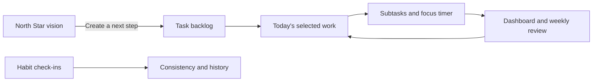

# Balance OS

**A capacity-aware planning app that connects daily priorities, focused work, and long-term direction.**

Balance OS brings tasks, subtasks, time tracking, habits, and weekly reflection into one React application. Rather than treating the backlog as today's to-do list, it separates what could be done from what fits into the day.

Built by Maria Blair with AI-assisted development workflows. This repository is named `Stabilization-OS`; the product is **Balance OS**.

**React 19 · TypeScript · Vite · Supabase · TanStack Query · Tailwind CSS 4 · Recharts**

[Open the app](https://stabilization-os.pages.dev) · [Architecture](#architecture) · [Run locally](#run-locally) · [Tests](#tests) · [Design system](./design.md)

## The product

Two planning modes serve different needs:

- **Life** suggests a small daily stack, taking priorities, waiting states, and remaining capacity into account.
- **Builder** shows tasks explicitly selected for today, keeping the project backlog out of the day's allocated time.

Both modes connect to subtasks, a focus timer, completed-work history, and progress reporting. Long-term ideas have their own **North Star** space so aspirations do not inflate today's workload.



*The deployed app requires sign-in. This diagram shows the workflow without exposing a personal workspace.*

## What you can do

| Area | Workflow |
| --- | --- |
| Daily planning | Select work, pin priorities, adjust each mode's daily capacity, and compare time spent, allocated time, and remaining room. |
| Task management | Organize tasks by category, break work into subtasks, record context and next actions, and move items between backlog, today, pending, done, and archived states. |
| Time tracking | Start, pause, and stop subtask timers; record missed time manually; review session history. Timer state is persisted. |
| Habits | Log Done, Partial, or Skip; group routines by time of day; explore weekly, monthly, and three-month history. |
| Reflection | Log wins independently of tasks and complete a guided weekly review of progress, estimates, and friction. |
| Reporting | View completion and tracked-time metrics, allocation charts, and open-loop trends, filtered by Life or Builder. |
| Long-term direction | Keep vision cards separate from actionable tasks and create linked next steps when ready. |
| Portability | Export JSON bundles and CSV task/time summaries from Settings. |

## Engineering highlights

### Responsive editing without a write on every keystroke

Text-heavy and numeric forms keep a local draft while the user types and save on blur or an explicit action. Task detail tracks dirty fields so query refreshes can update other values without replacing in-progress edits. This is a local editing pattern over server-backed data, **not an offline-sync engine**.

### Task state and time are related, but not interchangeable

Estimates and recorded time are attached to subtasks and rolled up to the task. Every task retains at least one subtask. Partial subtask completions appear in daily progress even before the parent task is complete. Removing a task from today does not erase its history.

### Server state and identity have explicit boundaries

TanStack Query manages fetched application state. Supabase handles authentication and persistence; authenticated routes are grouped behind `ProtectedRoute`. Database migrations define user-owned rows and row-level policies. 

### Compact, intentional UI

The interface favors data density, clear primary actions, and shared light/dark tokens rather than oversized dashboard cards. [The design system](./design.md) documents the visual language and component conventions.

## Architecture

```text
React Router pages and UI components
        │
        ├── Local form drafts and interaction state
        ├── TanStack Query hooks (server reads)
        └── Domain operations and timer hooks
                         │
                 Supabase Auth + database
```

Useful starting points:

| Path | Purpose |
| --- | --- |
| [`src/App.tsx`](./src/App.tsx) | Providers, public authentication routes, protected application routes |
| [`src/pages/TodayPage.tsx`](./src/pages/TodayPage.tsx) | Life/Builder selection, capacity, daily work, and completion views |
| [`src/pages/TaskDetailPage.tsx`](./src/pages/TaskDetailPage.tsx) | Draft editing, subtasks, status changes, and time history |
| [`src/hooks/useData.ts`](./src/hooks/useData.ts) | Query hooks and database-to-application mapping |
| [`src/db.ts`](./src/db.ts) | Task types and domain operations |
| [`src/habits.ts`](./src/habits.ts) | Habit scheduling and history logic |
| [`supabase/migrations`](./supabase/migrations) | Database schema and policies |
| [`src/__tests__`](./src/__tests__) | Daily-stack and habit tests |
| [`DATA-ACCESS.md`](./DATA-ACCESS.md) | Authenticated data CLI, previews, and safe operational workflow |

## Run locally

Use a current Node.js LTS release and npm. Node.js 22 or later also supports the data CLI's environment-file loading.

```bash
git clone https://github.com/mashablair/Stabilization-OS.git
cd Stabilization-OS
npm ci
```

1. Prepare **your own development Supabase project**, not an existing personal workspace.
2. Apply the SQL files in [`supabase/migrations`](./supabase/migrations) in numeric order. `001_initial_schema.sql` creates the base tables; `002_add_timezone.sql` adds timezone settings; `003_north_star.sql` adds the vision board.
3. Create a local `.env` file:

   ```dotenv
   VITE_SUPABASE_URL=https://YOUR_PROJECT.supabase.co
   VITE_SUPABASE_ANON_KEY=YOUR_PUBLIC_ANON_KEY
   ```

   Vite exposes `VITE_` variables to the browser. Never put a Supabase service-role key, password, or other secret in them. The local `.env` files are git-ignored.
4. Configure Supabase Auth for your development URL and password-reset redirect, then start the app:

   ```bash
   npm run dev
   ```

5. Open [localhost:5173](http://localhost:5173) and use your own development account. Use fictional tasks for testing or screenshots.

The app seeds default Life and Builder categories and an initial sample task for a new workspace. This is not a credential-free public demo.

## Tests

The domain tests import the Supabase client but do not need a live database. For a fresh checkout without `.env`, supply local placeholder configuration:

```bash
VITE_SUPABASE_URL=http://127.0.0.1:54321 VITE_SUPABASE_ANON_KEY=local-test-placeholder npm test
```


```bash
npm test            # Vitest: daily-stack and habit logic
npm run test:data   # Node tests: data-tool validation and North Star migration behavior
npm run lint        # ESLint
npm run build       # TypeScript project build + Vite production bundle
npm run preview     # Serve the built bundle locally
```

The test suites cover scheduling, capacity overrides, waiting/archived states, habit consistency, stable batch IDs, and preservation of existing records during the data-tool workflow. See [verification notes](docs/PORTFOLIO_CHECK.md) for the latest checks and authenticated-flow limitations.

## Data and operational notes

Primary data includes categories, tasks and their subtasks, time entries, daily capacity, timer state, wins, habits and logs, weekly reviews, settings, and North Star cards.

- **Task lifecycle:** `BACKLOG` → `TODAY` → `IN_PROGRESS` → `DONE` → `ARCHIVED`, with `PENDING` for waiting work. Completing all subtasks completes the parent task; undoing completion returns it to the backlog.
- **Exports:** Settings provides a JSON bundle and CSV summaries. Check the exported bundle's contents before relying on it as a complete backup, especially for newer features.
- **Import/reset caution:** Settings import replaces data, and reset is destructive. Do not use either on a real workspace just to try the app. Prefer an isolated development project.
- **CLI:** `npm run data -- --help` lists supported commands. Read [DATA-ACCESS.md](./DATA-ACCESS.md) before using it. Mutations preview by default and require `--apply`; private sessions and snapshots stay in ignored `.balance-local/`.
- **Privacy:** Do not commit workspace exports, personal plans, credentials, or screenshots containing real records.

## Deploy to Cloudflare Pages

Build the repository root with `npm run build` and publish `dist`. Configure the two public Supabase client variables in the build environment, use a supported Node.js LTS version, and configure Supabase Auth URLs for the deployed origin.

[`public/_redirects`](./public/_redirects) serves `index.html` for client-side routes so deep links and refreshes reach React Router. A custom domain can be configured through the Pages project.

Deployment requires your own backend configuration. Publishing the frontend alone does not provision the database or validate its access policies.
